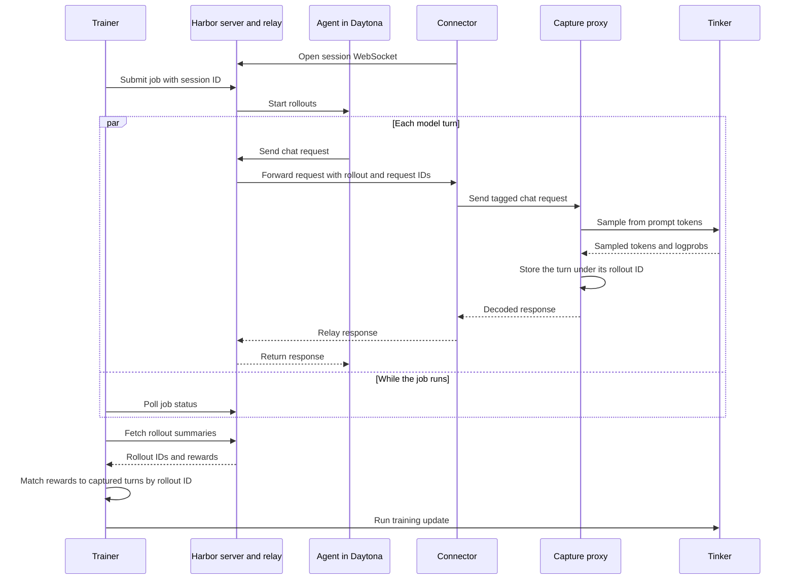

# Harbor RL

RL training on Harbor formatted tasks (e.g., Terminal Bench 2.0) with sandboxed code execution. An agent gets a bash tool inside a sandboxed container, attempts a task, and receives reward based on test results.

## Train through a Harbor server

Run these commands from the cookbook root with Python 3.12+. The trainer and Harbor server can share a virtual environment. If you run them separately, the server needs access to the tasks at the same absolute paths as the trainer. Claude Code runs in Daytona.

**Trainer setup**

```bash
uv venv --python 3.12
source .venv/bin/activate
uv pip install -e '.[harbor]'
harbor datasets download terminal-bench@2.0 -o ~/.cache/harbor/tasks/terminal-bench-2.0/
```

**Terminal 1 — Start ngrok** and copy its HTTPS forwarding URL.

```bash
export NGROK_AUTHTOKEN="<your-ngrok-authtoken>"
ngrok http 127.0.0.1:8390
```

**Terminal 2 — Start Harbor** with the URL from terminal 1.

```bash
source .venv/bin/activate
uv pip install 'harbor[daytona]>=0.26.0'
export DAYTONA_API_KEY="<your-daytona-api-key>"
export HARBOR_API_KEY="<your-harbor-key>"
harbor serve --relay-url "https://<your-ngrok-domain>"
```

**Terminal 3 — Run the trainer.** Keep terminals 1 and 2 running. The trainer starts the proxy and connector.

```bash
source .venv/bin/activate
export TINKER_API_KEY="<your-tinker-api-key>"
export HARBOR_API_KEY="<your-harbor-key>"  # Same value as terminal 2
python -m tinker_cookbook.recipes.harbor_rl.scripts.train_terminal_bench \
  harbor_server_url=http://127.0.0.1:8390 \
  model_name=Qwen/Qwen3.5-4B \
  groups_per_batch=1 group_size=1 max_steps=2 eval_every=0
```

This tests the relay with one rollout per round, two rollouts total. For a
reward-driven update, use `group_size=2` or larger: rewards must differ within a group.
To see two concurrent jobs share a relay session, set `groups_per_batch=2`.

The trainer joins Harbor rewards to Tinker's sampled tokens and log probabilities
by rollout ID. Captures are stored under `<log_path>/capture`.



## HarborTask
Harbor offers a standardized format for SWE/Terminal-Bench style task.
Adhering to this allows seperation between task creation layer and evaluation/training harness layer.
We can download the harbor datasets through `uvx harbor datasets download terminal-bench@2.0`.
By default, the task will land in `~/.cache/harbor/tasks/` with the structure
```
~/.cache/harbor/tasks/
  └── <shortuuid(task_id)>/       # deterministic hash for deduplication
      └── <task_name>/            # human-readable task directory
          ├── environment/
          │   └── Dockerfile
          ├── tests/
          │   └── test.sh
          ├── instruction.md
          ├── task.toml
          └── solution/
```
To use harbor tasks for training or evaluation, we designed the following interface

```python
@dataclass(frozen=True)
class HarborTask:
    task_name: str
    instruction: str
    task_dir: Path      # must contain environment/Dockerfile and tests/test.sh
    config: dict[str, Any] = field(default_factory=dict)
```

You can load your downloaded tasks (e.g., 89 Terminal-Bench tasks) via `load_harbor_tasks()` in `launch_terminal_bench.py`:

```python
from tinker_cookbook.recipes.harbor_rl.launch_terminal_bench import load_harbor_tasks

tasks = load_harbor_tasks()  # reads from ~/.cache/harbor/tasks/ by default
print(f"Loaded {len(tasks)} tasks")
print(tasks[0].task_name, tasks[0].task_dir)
```
The training environment is implemented against this interface.
You can customize your own task as long as they conforms to the interface above.

## Sandbox Protocol and custom backends

### The Protocol

`tinker_cookbook.sandbox.sandbox_interface` defines `SandboxInterface`:

```python
@runtime_checkable
class SandboxInterface(Protocol):
    async def run_command(self, command: str, workdir: str | None = None, timeout: int = 60, max_output_bytes: int | None = None) -> SandboxResult: ...
    async def read_file(self, path: str, max_bytes: int | None = None, timeout: int = 60) -> SandboxResult: ...
    async def write_file(self, path: str, content: str | bytes, executable: bool = False, timeout: int = 60) -> SandboxResult: ...
    async def send_heartbeat(self) -> None: ...
    async def cleanup(self) -> None: ...
```

`ModalSandbox` implements this interface.

### SandboxFactory and injection

`harbor_env.py` defines a backend-agnostic factory type and a default Modal implementation:

```python
SandboxFactory = Callable[[Path, int], Awaitable[SandboxInterface]]

async def default_sandbox_factory(env_dir: Path, timeout: int) -> SandboxInterface:
    """Create a Modal sandbox from a task environment directory."""
    import modal
    dockerfile_path = env_dir / "Dockerfile"
    image = modal.Image.from_dockerfile(path=str(dockerfile_path), context_dir=str(env_dir))
    return await ModalSandbox.create(image=image, timeout=timeout)
```

The first argument is the task's `environment/` directory (containing a Dockerfile and build context). Each backend converts this to its own image format internally (e.g. Modal builds a `modal.Image`).

`cli_main()` accepts an optional `sandbox_factory` parameter. When `None`, it falls back to `default_sandbox_factory` (Modal). The factory flows through: `cli_main` -> `HarborDatasetBuilder` -> `HarborEnvGroupBuilder.make_envs()`.

## Run without a Harbor server

The trainer creates Modal sandboxes directly. You can also supply a [custom sandbox factory](#sandboxfactory-and-injection).

```bash
uv pip install -e '.[modal]'
```

First, download the Terminal-Bench tasks:

```bash
uvx harbor datasets download terminal-bench@2.0 -o ~/.cache/harbor/tasks/terminal-bench-2.0/
```

Then launch training:

```bash
python -m tinker_cookbook.recipes.harbor_rl.scripts.train_terminal_bench \
    model_name=moonshotai/Kimi-K2.6 \
    max_tokens=8192 \
    group_size=4 \
    groups_per_batch=8 \
    learning_rate=1e-5 \
    lora_rank=32 \
    wandb_project=cookbook_harbor_rl
```

## Evaluation

Evaluate a Tinker endpoint on Harbor datasets without training.

Download datasets:
```bash
uvx harbor datasets download terminal-bench@2.0 -o ~/.cache/harbor/tasks/terminal-bench-2.0
uvx harbor datasets download swebench-verified@1.0 -o ~/.cache/harbor/tasks/swebench-verified-1.0
```

Run evaluation:
```bash
uv run python tinker_cookbook/recipes/harbor_rl/scripts/eval_harbor_rl.py \
    checkpoint_url=tinker://YOUR_CHECKPOINT/sampler_weights/final \
    benchmarks=terminal_bench,swe_bench \
    max_turns=200 \
    max_tokens=8192 \
    temperature=1.0
```

Key parameters in `EvalConfig`: `checkpoint_url`, `max_turns`, `max_tokens`, `temperature`.
`run_eval()` also accepts `sandbox_factory` for custom sandbox backends and `output_path` to control where results are written (default: `tinker_cookbook/recipes/harbor_rl/scripts/results/<timestamp>/`).

We evaluated SWE-Bench-Verified-1.0 and Terminal-Bench-2.0 at 32K context length and naive agent harness with no advanced features like context compatification that summarizes the tool calling history.

### Results: Kimi-K2.6 (32K context, no compaction)

| Benchmark | Total | PASS | FAIL | ERROR | Pass Rate |
|-----------|-------|------|------|-------|-----------|
| SWE-Bench Verified 1.0 | 500 | 145 (29.0%) | 52 (10.4%) | 303 (60.6%) | 29.0% |
| Terminal-Bench 2.0 | 89 | 14 (15.7%) | 31 (34.8%) | 44 (49.4%) | 15.7% |

**Config**: `max_turns=200, max_tokens=8192, temperature=1.0, sandbox_timeout=3600s`

All ERRORs are context window overflow (`prompt_tokens + max_tokens > 32768`).
These occur when the conversation history exceeds ~24.5K tokens, leaving insufficient room for the 8192 `max_tokens` generation budget.
