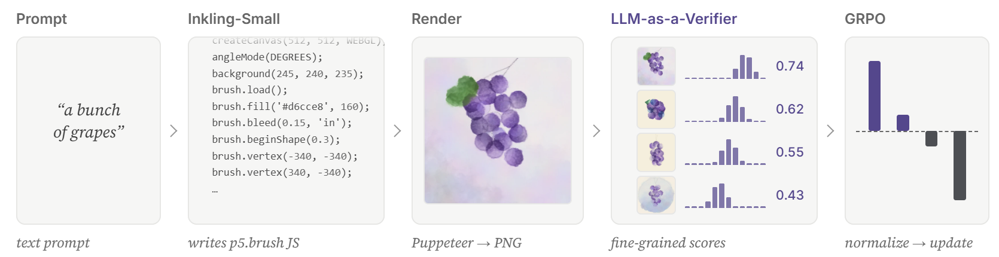
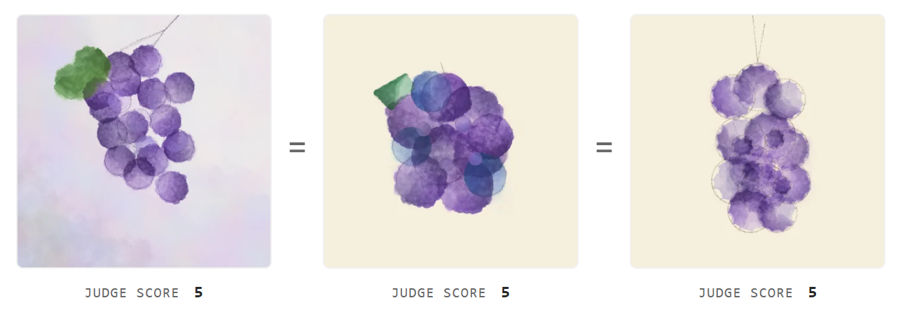
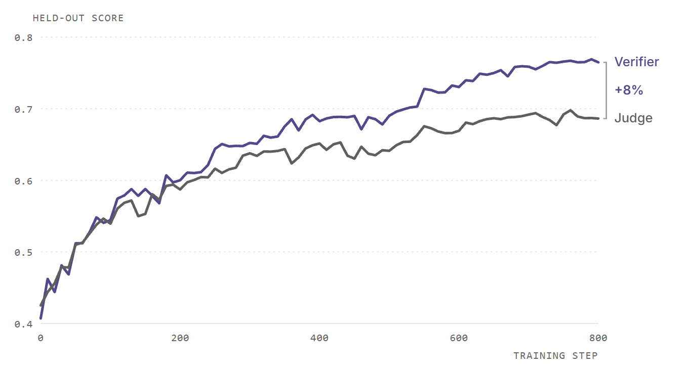

# 🎨 Training LLMs to Paint with RL and Self-Verification

This repository contains the code for training `thinkingmachines/Inkling-Small` to create watercolor paintings through reinforcement learning (RL) and fine-grained self-verification. The policy first generates JavaScript sketches using `p5.brush`, which are rendered into watercolor paintings in a browser. [LLM-as-a-Verifier](https://github.com/llm-as-a-verifier/llm-as-a-verifier), a verification scaling framework, then evaluates the rendered paintings and provides fine-grained reward signals for RL. `Inkling-Small` is used as both the generator and the verifier. Compared with a standard LLM-as-a-Judge reward baseline, LLM-as-a-Verifier achieves up to 1.7× higher sample efficiency.



## Setup

Requires Python 3.12. Run the following commands from the repository directory:

```bash
pip install -r requirements.txt
python -m playwright install --with-deps chromium

# Link this folder into the installed cookbook
ln -s "$PWD" "$(python -c 'import tinker_cookbook.recipes as r; print(r.__path__[0])')/paint_rl"

# API key
export TINKER_API_KEY=...
```

`TINKER_API_KEY` is required for policy training and verification.

## Training

Train Inkling-Small using LLM-as-a-Verifier rewards:

```bash
python -m tinker_cookbook.recipes.paint_rl.train \
    reward_mode=verifier max_steps=800 log_path=/tmp/paint_rl/verifier
```

Both `reward_mode=verifier` and `max_steps=800` are the defaults and are shown explicitly for clarity.

For multiple runs, specify `seed=1`, `seed=2`, etc. The seed controls prompt ordering and reward-model sampling, while the training and held-out splits remain fixed.

### Training configuration

| Setting | Configuration |
| --- | --- |
| Policy | Inkling-Small, LoRA rank 32, thinking effort 0.7, temperature 1.0 |
| Optimization | Learning rate 4e-5, importance-sampling loss, 800 steps |
| Batch size | 8 prompts × 5 rollouts per step |
| Prompts | 256 training, 50 held-out (subject × color × watercolor style) |
| Rendering | 512 px canvas, headless Chromium |
| Checkpoints | Saved every 10 steps, indexed in `<log_path>/checkpoints.jsonl` |

## Held-Out Evaluation

Run during or after training:

```bash
# DeepSeek-V4.1-Flash (default)
export DEEPSEEK_API_KEY=...
python -m tinker_cookbook.recipes.paint_rl.eval_checkpoints \
    log_path=/tmp/paint_rl/verifier

# Or Kimi-K2.6 through the Tinker API (only TINKER_API_KEY needed)
python -m tinker_cookbook.recipes.paint_rl.eval_checkpoints \
    log_path=/tmp/paint_rl/verifier \
    evaluator.model_name=moonshotai/Kimi-K2.6 \
    evaluator.api_base_url=None \
    out_dir=/tmp/paint_rl/verifier/heldout_eval_kimi
```

The base model and the checkpoint at every 10th step each paint 50 held-out prompts five times (250 paintings). The evaluator grades each painting A–J on the same three criteria; it is never used for training rewards.

## Fine-Grained Self-Verification Rewards

```python
reward = 0.05 * compiled + 0.05 * length_ok + 0.90 * score
```

- **`compiled`**: the sketch runs, uses the brush library, and paints a non-blank canvas.
- **`length_ok`**: the code is between 300 and 8,000 characters.
- **`score`**: the LLM-as-a-Verifier score; zero if the sketch fails to compile.

Inkling-Small (thinking effort 0.2) is its own verifier. Each group of five paintings is scored with a round-robin tournament: every pair is compared, and verification is scaled along three dimensions:

- **Fine-grained scoring:** grades use a 20-level scale (A–T), read as the expected score under the verifier's token probabilities.
- **Repeated verification:** each pair is scored four times per criterion, swapping the order on odd repeats to cancel positional bias.
- **Criteria decomposition:** Subject and Prompt Fidelity, Watercolor Technique, and Composition and Aesthetic Appeal are scored separately.

That is 120 verifier calls per group. For a prompt $x$ and painting $\tau$, the score is

$$R(x,\tau)=\frac{1}{CK}\sum_{c=1}^{C}\sum_{k=1}^{K}\sum_{g=1}^{G}p_\theta(v_g\mid x,c,\tau)\,\phi(v_g)$$

with $C=3$ criteria, $K=4$ repeats and $G=20$ score tokens; $p_\theta$ is the verifier's probability of score token $v_g$, and $\phi$ maps it to a scalar. Rewards are normalized within each group before the policy update.

## Baseline: LLM-as-a-Judge

To compare against conventional LLM-based reward modeling, train with:

```bash
python -m tinker_cookbook.recipes.paint_rl.train \
    reward_mode=judge max_steps=800 log_path=/tmp/paint_rl/judge
```

This replaces the verification tournament with a standard **LLM-as-a-Judge**, which independently grades each painting on an A–J scale for each criterion.

All other training configurations remain identical, enabling a controlled comparison of reward signals using the same held-out evaluator.

### Limitations of discrete judging

A key limitation of conventional LLM-as-a-Judge scoring is its inability to reliably distinguish between candidates of different quality.

For example, the judge assigns the same score of 5 to three visually distinct paintings of grapes, producing a three-way tie despite meaningful differences in artistic quality.



By computing continuous, probability-weighted scores and scaling verification across repeated evaluations and decomposed criteria, LLM-as-a-Verifier provides a more discriminative reward signal for policy optimization.

## Evaluation Results

Held-out scores from DeepSeek-V4.1-Flash on 250 paintings per evaluation, averaged over three seeds. At step 800, LLM-as-a-Verifier scores **0.765** against **0.686** for LLM-as-a-Judge (+8%). The verifier reaches the same held-out score in 1.23× to 1.69× fewer steps.



| Target Held-out Score | LLM-as-a-Judge | LLM-as-a-Verifier | Steps Saved | Speedup |
| --- | --- | --- | --- | --- |
| 60% | 215 | 175 | 40 | 1.23× |
| 65% | 400 | 260 | 140 | 1.54× |
| 68% | 610 | 360 | 250 | 1.69× |

## Outputs and Visualization Tools

Every rollout is saved under `<log_path>/paintings/`, including its generated JavaScript, rendered PNG, and verification scores. Metadata is indexed in `index.jsonl`.

The repository also includes visualization and analysis utilities:

| Script | Description |
| --- | --- |
| `gallery.py` | Generates an HTML gallery of paintings across training steps |
| `progression.py` | Creates contact sheets showing the best paintings at each step |
| `compare_runs.py` | Plots training and held-out evaluation curves across runs |

## Citation

If you find this work useful, please consider citing:

```bibtex
@article{kwok2026creative,
  author = {Kwok, Jacky and Narreddi, Surya and Wu, Neal and Franz, Cameron and Guo, Simon},
  title = {Training LLMs to Paint with RL and Self-Verification},
  journal = {Thinking Machines Lab: Connectionism},
  year = {2026},
  month = {Nov}
}

@misc{kwok2026llmasaverifiergeneralpurposeverificationframework,
  title = {LLM-as-a-Verifier: A General-Purpose Verification Framework},
  author = {Jacky Kwok and Shulu Li and Pranav Atreya and Yuejiang Liu and Yixing Jiang and Chelsea Finn and Marco Pavone and Ion Stoica and Azalia Mirhoseini},
  year = {2026},
  eprint = {2607.05391},
  archivePrefix = {arXiv},
  primaryClass = {cs.AI},
  url = {https://arxiv.org/abs/2607.05391}
}
```
